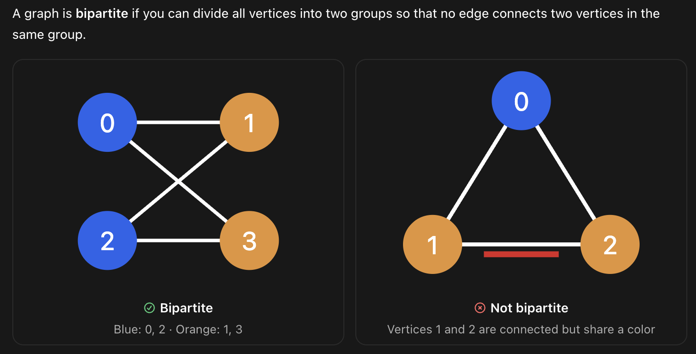

# CSCI 62 Exam Review

This repository contains materials for reviewing exams in **CSCI 62**.

## Topics

### Quiz 1: Graph Traversal, Linux command, Makefile

- **Breadth-First Search (BFS)**
- **Depth-First Search (DFS)**

See the C++ implementation: [quiz1_bfs_dfs.cpp](./quiz1/quiz1_bfs_dfs.cpp)

- **Eccentricity**: The maximum distance from v to another vertex, where “distance” refers to the distance along the shortest path.
  
See the C++ implementation: [quiz1_eccen.cpp](./quiz1/quiz1_eccen.cpp)

- **Makfiles**

See the C++ implementation: [makefile_guide.txt](./quiz1/makefile_guide.txt)

- **Linux Command**

See the Command in Linux: [linux_command.txt](./quiz1/linux_command.txt)

- **Topo sort: DFS**

See the C++ implementation: [quiz1_toposort.cpp](./quiz1/quiz1_toposort.cpp)

### Midterm1: Topics in Quiz1 + Inheritance and Polymorphism

- **Inheritance and polymorphism**

See the C++ implementation: [medicalprovider.cpp](./midterm1/medicalprovider.cpp)

C++ header file implementation: [medicalprovider.h](./midterm1/medicalprovider.h)

- **Breadth-First Search (BFS) --> distance**

See the C++ implementation: [midtermgraph1.cpp](./midterm1/midtermgraph1.cpp)

- **Depth-First Search (DFS) --> # of connected components**

See the C++ implementation: [midtermgraph2.cpp](./midterm1/midtermgraph2.cpp)

- **Bipartite graph -> dfs application**

Bipartite graph is a graph that can be divide into group, and vertecies in each group aren't connect with each other. For instance I have group A,B in the graph. A1 is not connected with A2, but connected with B1; A2 is connected to B1 but not A1. It works the same way reversly.

See the C++ implementation: [bipartite_graph.cpp](./midterm1/bipartite_graph.cpp)

- **Inheritance and polymorphism -> dewelling class**

For functions in parent class, if the child have same function in their class, and want the function in child behave in their own way, we need to add a "virtual" infront of the function in parent; For the function Parent class that takes in the type of input that is "Parent", if we want this function also works for type child, make the input pointer. We can let parent pointer point to child class, this is how polymorphism works.

See the C++ implementation: [dwelling.cpp](./midterm1/dwelling.cpp)